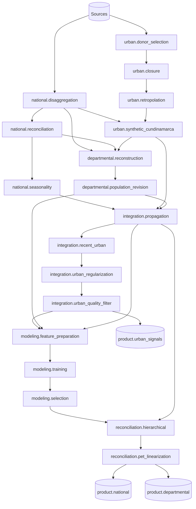

# RC1 canonical lineage

This document records how the RC1 canonical outputs are actually produced
in the legacy RC2 tree. It was reconstructed by tracing every
`read_csv`/`to_csv` call of the scripts on the canonical path and by
verifying byte-identical copies between phases (SHA-256). The catalog in
`configs/golden/rc1_catalog.toml` lists all 59 artifacts with their hashes.

## Stage graph

## Findings that shape the migration

1. **Canonical inputs live inside experiment folders.** For example, the
   departmental and integration stages read
   `01_nacional/experimentos/03_.../exports/visualizacion/06_tablas/serie_combinada_con_procedencia.csv`,
   i.e. a table written by the *visualization* step. In the package, this
   becomes the explicit artifact `national.combined_with_provenance`.
2. **Phases are coupled by copies.** Confirmed identical copies include
   `06/inputs/nacional_mensual.csv` = integration output,
   `03/fuentes/nacional_*` = national outputs, and the hito 4 inputs =
   hito 2/3 outputs. The artifact store replaces all of them.
3. **The canonical seasonal variant is `08_estacionalidad_063_v04_componentes`**
   (not v01–v03), as read by `propagar_consolidar.py`.
4. **Not every source can be regenerated from raw DANE files.** Several
   inputs were produced by the original notebooks and are frozen as
   `legacy_derived` (e.g. `senales_historicas_23_y_donantes.csv`, which is
   byte-identical to the legacy `legacy_pea_restored.csv`, and
   `indicadores_mensuales_1993_2003.csv`, which already contains spliced
   labor series; the national stage only uses its price-index columns). Two inputs of the selection stage
   (`objetivos_test.csv`, `poblacion_proyeccion.csv`) have no traced
   producer in RC2.
5. **Observed GEIH rows carry rounding residuals.** In the national
   product, `labor_force - employed - unemployed` reaches 1 person on
   observed rows, while every estimated row closes to ~1e-8. The identity
   contract is therefore provenance-dependent (`icml.domain.contracts`).
6. **Products mix data and audit.** The departmental RC1 product has 55
   columns, including pre-closure predictions and adjustment diagnostics.
   The future product contract separates the published table from its
   audit trail; the RC1 schema remains available for regression.
7. **Bogotá has no departmental anchor in RC1.** The 2025 departmental
   annex publishes 23 territories; Bogotá D.C. (11) is not among them, so
   it is one of the ten territories predicted by the model downstream.
8. **The departmental B1 stage does not use the urban signals
   numerically.** B1_v03 only validates that the 33-signal file exists
   with the expected structure; the signals enter at integration.
